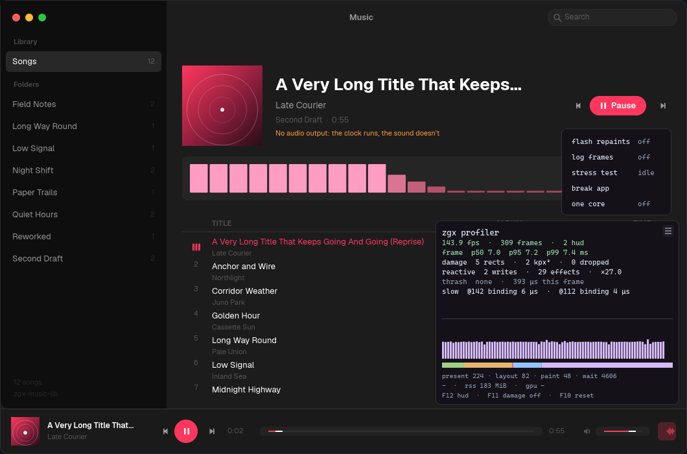

# Profiling a zgx app

`zgx-profiler` measures what a window does each frame and shows it in a HUD,
or writes it to a Chrome trace.



## Attaching it

A Luau app needs no code:

```sh
zgx-run --profile app/
```

`ZGX_PROFILER=1` does the same for any run. `ZGX_PROFILER_TRACE=1` also
writes `zgx-profile.json` when the window closes, into `ZGX_PROFILER_OUT`
when it is set. A build for shipping leaves the profiler out with
`zgx-run`'s other devtools (`--no-default-features`).

A Rust app attaches it with one line in the window's setup:

```rust
zgx_profiler::attach(cx, zgx_profiler::Config::default());
```

or `zgx_profiler::attach_if_asked(cx)` to attach only when `ZGX_PROFILER=1`.

## Keys

| Key | What it does |
| --- | --- |
| `F12` | show or hide the HUD |
| `F11` | outline the last frame's damage rects |
| `F10` | forget every frame kept and start the recording over |

`attach` binds them itself. An app that wants other keys sets
`Config::keys` to `false`, binds `zgx_profiler::keymap()` or its own, and
calls `Profiler::toggle`, `Profiler::toggle_damage` and `Profiler::clear`.

## The dev menu

The button at the HUD's top right opens five switches:

| Row | What it does |
| --- | --- |
| flash repaints | flashes each area the app repaints, fading |
| log frames | writes every app frame to `zgx-profile-log.txt` as it happens |
| stress test | a redraw storm, a pointer sweep and scrolls, each measured, to `zgx-stress-report.txt` |
| break app | writes every frame kept to `zgx-crash-dump.txt`, then panics |
| one core | pins the process to one core, so what parallelism hides shows |

Files go to `Config::out_dir`, the working directory by default.

## The HUD

`zgx_profiler::attach(cx, Config::default())` turns on zgx's frame tracing
(`zgx::trace`) and watches the frames the desktop host publishes
(`zgx::diagnostics`). The HUD is a tree of ordinary scene nodes above the
interface, inert, rewritten at most 30 times a second. It shows:

- **Frames per second** of the app's own frames (frames the overlay itself
  caused are counted apart, as `hud`).
- **Frame pacing**: p50, p95 and p99 of the interval between frames, and how
  many frames arrived late (more than 1.5× the median).
- **Phases of the last frame**, as a stacked bar and in microseconds:
  input, script, update, layout, text, damage, paint, encode, submit and
  present. `wait`, time spent waiting for the display, is listed last and
  left out of the bar, the frame's total and the phase that took it: it is
  not work.
- **Damage**: how many rects the frame repainted, their area, and
  `F11` outlines them over the window.
- **Reactive work**: signals written, effects run, and the widest cascade (the
  most effects one signal write queued). A signal written more than three
  times in one frame is flagged as thrashing, with its address.
- **Attribution**: the costliest named effects of the last frame
  (`slow app.luau:30 1.2 ms · @5 binding 0.3 ms`), what the engine's own
  effect names say ran.
- **Why**: the engine's note on what the last frame did (`a scroll repainted
  rather than copied`), and a whole-window repaint named as `full repaint`.
- **The worst frame** kept: the late frame since the recording began (or
  `F10`), with the phase that took it and its costliest effect. A steady
  frame never counts, however slow the app is on the whole.
- **A pacing graph** whose bars are coloured by the phase that took each
  frame: a layout-coloured spike and a paint-coloured one read apart at a
  glance. The line across it is a 16.7 ms budget.
- **Resident memory**, and the instructions the last frame's phases retired
  where the platform counts them (macOS and Linux; `-` elsewhere).

The HUD counts the frames *the app* drew: the overlay's own repaints are
removed from the damage figures, so with the app idle the numbers read
0 fps and near-zero damage instead of measuring the HUD itself. Frames that
paint nothing (`idle`) are counted apart too.

## A trace, in Perfetto

`Config::export_chrome_trace` writes `zgx-profile.json` when the window
closes, and `Profiler::export(path)` writes the same file on demand. Open the
trace at
[ui.perfetto.dev](https://ui.perfetto.dev) or `chrome://tracing`:

- One slice per phase per frame (`frame` category), so a frame's split reads
  as a stacked timeline, with each phase's retired instructions where
  counted.
- An instant event per frame with its damage rects, node counts, reactive
  work, GPU time where measured, and whether the frame was the overlay's.
- Counter tracks for frame interval, damaged area, signal writes, effects
  and instructions.
- Instant events (`effect`) for the costliest named effects of each frame,
  with the signal whose write queued them, and instant events (`why`) for the
  engine's notes on what the frame did.
- One instant (`worst frame`) with the late frame's split, wherever it fell.
- Slices on a `segments` track, one per marker-delimited stretch of the
  capture, each with its frames, fps, p50/p95, damaged area and mean phase
  costs: two scenarios named with `Profiler::mark` compare without counting
  pixels by hand. `Profiler::segments()` returns the same numbers in code.
- Instant events for markers written with `Profiler::mark`, so two stretches
  of a capture can be compared by name.

## Reading the numbers

Retired instructions repeat better than time, but the trace has time. For
what a phase's time is made of, `ZGX_PROFILE=1` still prints per-phase lines
on stderr every 120 frames, and `scripts/perf/` (see
[benchmarking](docs/benchmarking.md)) compares whole scenes by instructions.
This profiler answers the other question: *what did this window do, frame by
frame, and what did the app's own code cost.*

## Notes and limits

- Frames the host draws with nothing to paint are counted as `idle` frames,
  not as app frames.
- The HUD's own nodes are part of the frame's node counts (layout/paint in the
  trace) but its damage is removed from the damage figures; the HUD redraws at
  `Config::hud_rate`, 30 Hz by default.
- A gap longer than 600 ms between two app frames is the app idling, not a
  late frame: it is left out of the pacing figures and the worst frame.
